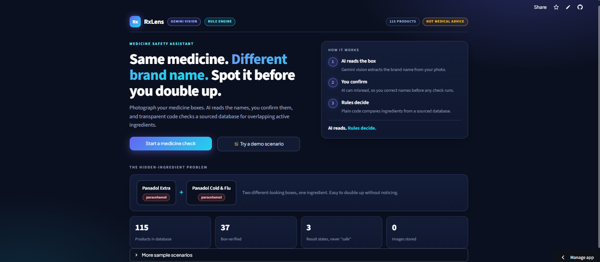
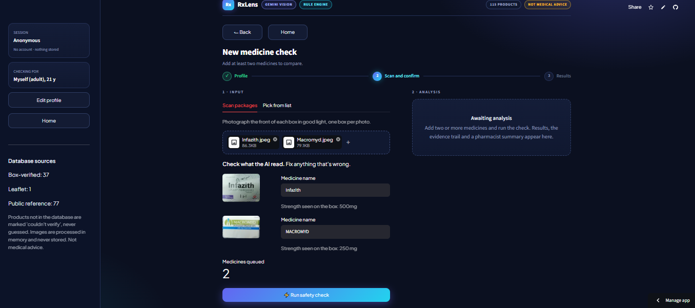
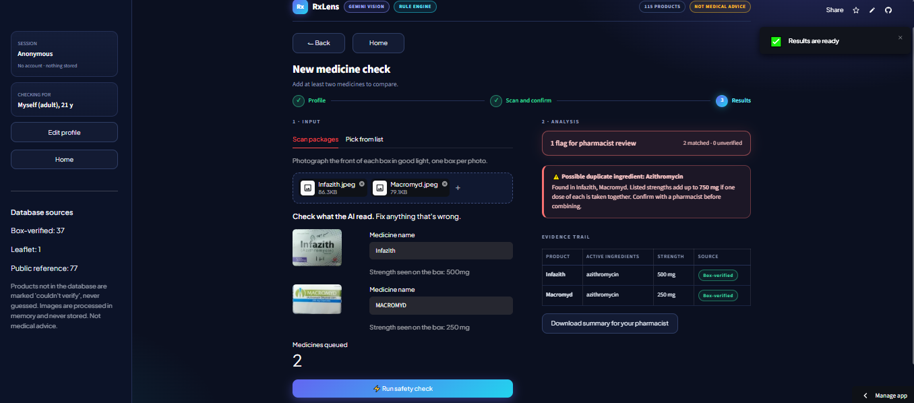
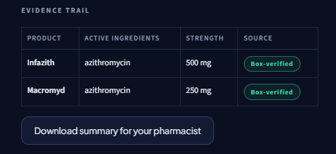
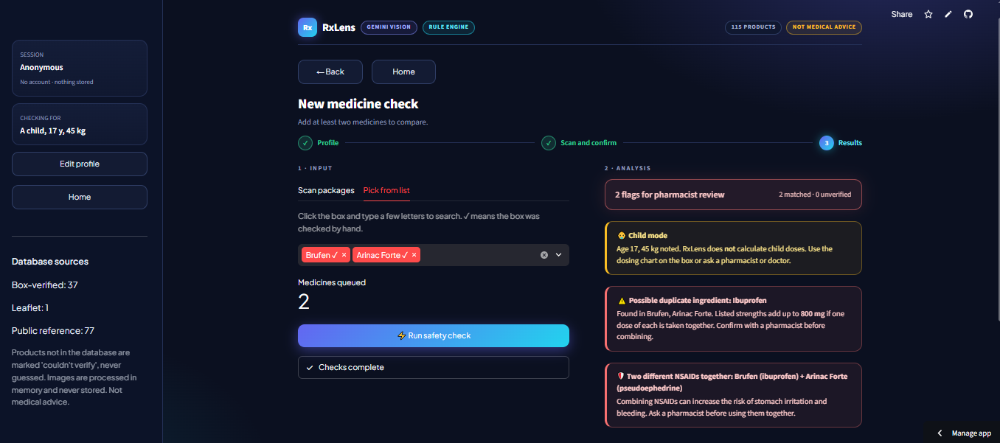

# rxlens
# RxLens 💊

AI-powered duplicate-ingredient checker for medicine packaging.

*Live demo:* https://rxlens-udwae5hf9jsmkkyrbuaeea.streamlit.app/
*Demo video:* https://canva.link/1zdshaotkgq11ea
*Built for:* NYLP AI Hackathon 2026

## Problem
The same active ingredient can hide under different brand names, for example
paracetamol in several pain, cold and flu products, or azithromycin sold under
different brands. People who take medicines from different doctors and shops
can double up without noticing, and overdose of common ingredients like
paracetamol is a well-known risk. Few people compare ingredient lists.

## Solution
Photograph your medicine boxes. AI reads the names, you confirm or correct
them, and plain, readable code checks a sourced database for overlapping
active ingredients, adds up listed strengths, and applies a few transparent
rules. RxLens flags possible duplication for pharmacist confirmation. It is
not medical advice.

## How the AI is used
1. **AI (Google Gemini vision):** reads the brand name and strength from a
   photo of the package. This is the only place AI is used.
2. **Human in the loop:** the user confirms or corrects every name before any
   check runs, because AI can misread.
3. **Deterministic code (no AI):** fuzzy name matching (rapidfuzz), ingredient
   overlap detection, dose summing and rules. The AI never makes the safety
   decision, so every result traces to a database row and a rule.

The model is prompted to return only JSON with `brand_name` and `strength`,
and to leave a field empty rather than guess. If the API is unavailable or its usage limit is reached, users can enter medicine names manually and use the duplicate-checking features.

## Features
- Photo scan or pick-from-list input
- Duplicate active-ingredient detection, including combination medicines
- Listed-dose summing, compared with usual adult label maximums (paracetamol)
- NSAID + different NSAID rule
- Allergy keyword check and child mode (never calculates child doses)
- Three result states: possible duplicate / none found among known products / couldn't verify
- Evidence trail showing each product's ingredients and data source
- One-click sample scenarios
- Downloadable summary to show a pharmacist
- No accounts; images processed in memory, not stored
- Never claims a combination is "safe"

## Evaluation
This prototype has undergone initial functional testing. A larger, systematic evaluation of medicine identification accuracy and duplicate detection is still needed.

## Data
`medicines.csv` holds each product's ingredients, strength, drug class and a
**source** column. N products come from boxes I checked myself ("verified box
scan"), N from a package leaflet, and N from public references, labelled
"not box-verified". The app shows the source for every match, and only
box-verified products are used in the demo and the evaluation.
- Paracetamol limits (1000 mg per dose, 4000 mg per day, adult): WRITE YOUR
  SOURCE (for example the Panadol leaflet).
- NSAID rule source: WRITE YOUR SOURCE, or "common pharmacy guidance, to be
  confirmed by a pharmacist".

## Tech stack
Python, Streamlit, Google Gemini API (vision), rapidfuzz, Pillow.

## AI tools used
- Google Gemini API: reads medicine names from images (inside the product)
- Claude (Anthropic): used as a coding assistant during development. I tested
  the code and can explain every file.

## Project structure
- `app.py`: the interface
- `core.py`: the AI reading call plus the rule-based checks
- `medicines.csv`: the database
- `test_ai.py`, `list_models.py`: helper scripts for testing the API

## Setup
1. Clone the repo
2. `pip install -r requirements.txt`
3. Create `.streamlit/secrets.toml` containing `GEMINI_API_KEY = "your-key"`
   (never commit this file)
4. Run `streamlit run app.py`

## Limitations
- Small database; unknown products are marked "couldn't verify", never guessed
- Packaging only; no handwritten prescriptions
- Only one interaction rule; "no duplicate found" is not a safety guarantee
- Dose summing assumes one dose of each product taken together
- Not medical advice

## Future work
Prescription reading, more interaction rules with sources, a
pharmacist-reviewed database, Urdu support.

## Team
Laiba Fatima: solo participant (idea, development, testing, documentation)